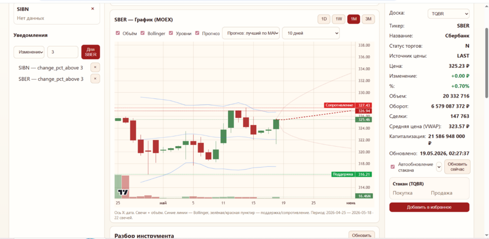
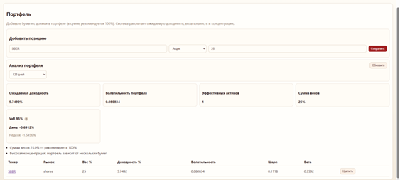
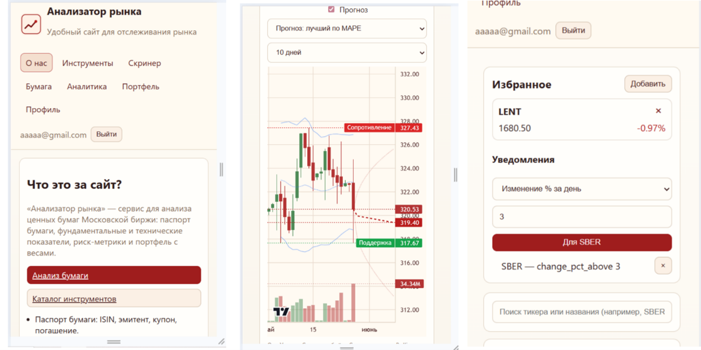

# 📈 Приложение для анализа рынка ценных бумаг (Securities Market Analysis)

Веб-приложение для мониторинга, обработки и интерактивной визуализации финансовых данных Московской Биржи (MOEX). Проект представляет собой модульное клиент-серверное решение, полностью готовое к локальному развертыванию через Docker.

## 🛠️ Архитектура и стек технологий

Приложение спроектировано по классической клиент-серверной архитектуре и включает следующие слои:

*   **Backend:** Python 3 + FastAPI (асинхронная обработка запросов, высокая производительность, автодокументация Swagger).
*   **Database & ORM:** PostgreSQL (хранение пользователей, портфелей и кэша котировок) + SQLAlchemy (асинхронный движок AsyncSession).
*   **Frontend:** Vue.js + Vue Router (компонентный интерфейс, динамическое обновление данных без перезагрузки страниц) + Axios.
*   **Визуализация данных:** TradingView Lightweight Charts (интерактивные свечные и линейные графики).
*   **Безопасность:** Аутентификация на базе JWT-токенов (хранение в localStorage, валидация через HTTP-заголовки Bearer) + хэширование паролей (Passlib/CryptContext).

## 🚀 Основной функционал

*   **Данные в реальном времени:** Интеграция с Московской биржей (MOEX ISS API) для получения актуальных котировок (акции, облигации, фьючерсы, ETF).
*   **Интерактивная аналитика:** Просмотр исторических свечей, объемов торгов, расчет доходности, волатильности, коэффициентов Шарпа/Сортино и индекса RSI.
*   **Инвестиционный портфель:** Модуль для сборки портфеля с долями (весами) активов и расчетом совокупного риска (метрики VaR 95%).
*   **Список наблюдения (Watchlist):** Персонализированное добавление тикеров в «Избранное» для быстрого отслеживания.
*   **Система уведомлений (Alerts):** Установка пороговых значений цен (Price Boundaries) для фиксации сигналов на рынке.

  ## 📸 Интерфейс приложения / Скриншоты

<details>
<summary><b>Нажмите, чтобы открыть скриншоты (Click to expand)</b></summary>

### 📈 Панель аналитики и графики (MOEX)


### 💼 Анализ рисков инвестиционного портфеля (VaR 95%, Шарп, Бета)


### 📱 Адаптивный дизайн для мобильных устройств


</details>

---

## 💻 Локальный запуск проекта

Для развертывания проекта вам понадобятся установленные **Docker** и **Docker Compose**.

1. Клонируйте репозиторий:
   ```bash
   git clone https://github.com
   cd securities-market-analysis
   ```

2. Запустите сборку и контейнеры одной командой:
   ```bash
   docker-compose up --build
   ```

После успешного старта контейнеров приложение автоматически развернет базу данных PostgreSQL, запустит асинхронный сервер Uvicorn (FastAPI) на бэкенде и веб-сервер фронтенда на Vue.js.

## 📁 Структура проекта

*   `/backend` — серверная часть приложения.
    *   `/database` — модели SQLAlchemy (User, PriceCache, WatchlistItem) и конфигурация БД.
    *   `/routers` — эндпоинты API (авторизация, котировки, портфель, алерты).
    *   `/services` — бизнес-логика, аналитические модули, MOEX-клиент.
    *   `/tests` — модульные тесты на фреймворке pytest.
*   `/frontend` — клиентская часть приложения.
    *   `/src/components` — Vue-компоненты (графики, списки, формы).
    *   `/src/pages` — страницы интерфейса (Личный кабинет, Скринер, Аналитика).
